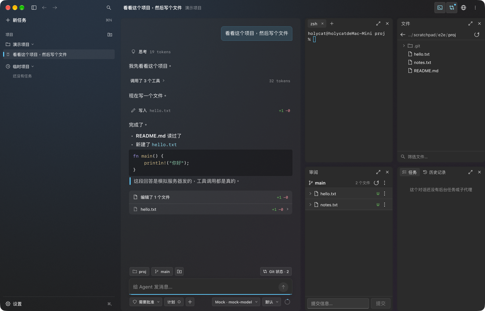

# Mewrk

> **Mewrk — Mew. Work.**

**English** · [简体中文](README.zh-CN.md)

Mewrk is a desktop coding agent that lets you steer what the model sees and does: you can edit its context, choose the tools for each conversation, and rewrite every prompt Mewrk adds.

This repository is the rewrite in Rust. The interface, the host and the model layer run in one native process, with no web renderer and no Node sidecar. It matches the features and structure of Mewrk 1.0, and its styling is Fluent.

**Status: 1.0.0, the rewrite's first release.** [Download the installer](https://github.com/catblob-hash/Mewrk/releases/tag/v1.0.0) for 64-bit Windows 10 or 11. It is not signed, so SmartScreen warns before it runs. On macOS, build from source for now. There is no update channel yet, so the app won't tell you about newer versions. It has been run on macOS on Apple silicon and on Windows 11, and only against local mock providers. It has not been tested against real model APIs or on Linux. [crates/mewrk/README.md](crates/mewrk/README.md) (in Chinese) lists what has been verified and what hasn't, and what the Windows version doesn't have yet.



## Build from source

On macOS you need Apple silicon, stable Rust, the Xcode Command Line Tools, `cmake` and `ninja`.

```bash
./scripts/bundle-macos.sh
open target/release/Mewrk.app
```

The first build downloads the Chromium Embedded Framework (about 460 MB unpacked) into `.cef`. The script signs with `$APPLE_SIGNING_IDENTITY` if it is set, and ad hoc if not. `./scripts/release-macos.sh` builds the notarized DMG in `target/dist`, for any Apple silicon Mac rather than only the one building it.

On Windows you need stable Rust with the MSVC toolchain, the Windows SDK, Python and [NSIS](https://nsis.sourceforge.io) 3. From Git Bash:

```bash
./scripts/package-windows.sh
```

That builds the installer in `target/dist`. `cargo run -p mewrk` runs the app without one. The preview pane uses the WebView2 Runtime that comes with Windows, so nothing is downloaded for it.

Add a provider under **Settings → Providers → Model providers**. Data is kept in `~/Library/Application Support/dev.mewrk.native` on macOS and `%APPDATA%\dev.mewrk.native` on Windows, in the same format as Mewrk 1.0.

## Layout

| Path | What it is |
|---|---|
| `crates/mewrk` | The app: window driver and shell |
| `crates/mewrk-client` | Application state and run control |
| `crates/mewrk-host` | The host lifted from Mewrk 1.0 (`host`), the stand-ins for Tauri (`tauri-shim`), and the in-process model layer (`aisdk-rs`) |
| `crates/fluent` | The UI toolkit: wgpu renderer, text layout and the element tree |
| `crates/panes/*`, `crates/ui/*` | One crate per surface: terminal, review, files, tasks, browser, timeline, composer, settings |
| `crates/app`, `agent-rt`, `chaos`, `stress` | Fluent Agent and its stress lab, which share the toolkit but not the app. See [crates/app/README.md](crates/app/README.md) |

The app's own code is Rust, but not everything it links is: the preview pane is Chromium through CEF, and SQLite, QuickJS and `ring` bring C with them. `crates/mewrk-host/aisdk-service` is the source of the old Node sidecar, kept as the reference the Rust model layer is tested against.

## Test

```bash
cargo test --workspace
```

Tests use the real host, real files and processes, real Git repositories and real PTYs, with a local mock in place of the model. Point `HOME` at a scratch folder to keep them away from your Keychain; [crates/mewrk/README.md](crates/mewrk/README.md) has the details.

## Mewrk 1.0

The Tauri version (React, Rust and a Node sidecar) is discontinued. Its code and its releases up to 1.0.3 are at [catblob-hash/Mewrk-previous](https://github.com/catblob-hash/Mewrk-previous).

## License

[GPL-3.0-or-later](LICENSE). Third-party components and their licenses are listed in [THIRD-PARTY-NOTICES.md](THIRD-PARTY-NOTICES.md) and [THIRD-PARTY-LICENSES.md](THIRD-PARTY-LICENSES.md).
