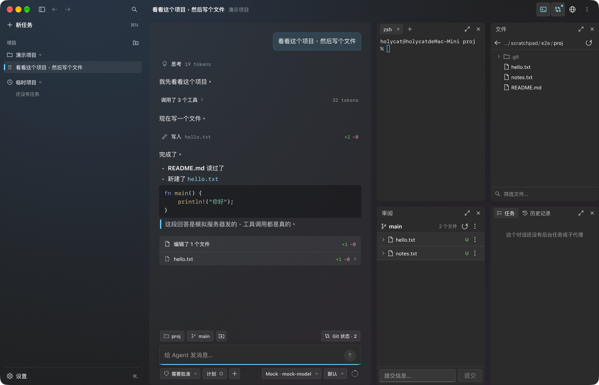

# Mewrk

> **Mewrk — Mew. Work.**

[English](README.md) · **简体中文**

Mewrk 是桌面编程 Agent，模型看到什么、做什么都由你掌控：可以编辑上下文，为每个对话选择工具，改写 Mewrk 添加的每一段提示词。

这个仓库是 Rust 重写版。界面、宿主和模型层都在同一个原生进程里，没有网页渲染器，也没有 Node sidecar。功能和结构与 Mewrk 1.0 对齐，样式是 Fluent。

**状态：1.0.0，重写版的第一次发布。** [下载安装包](https://github.com/catblob-hash/Mewrk/releases/tag/v1.0.0)，适用于 64 位 Windows 10 或 11。安装包没有签名，运行前 SmartScreen 会提示警告。macOS 暂时需要从源码构建。还没有更新渠道，所以应用不会提示新版本。目前在 Apple 芯片的 macOS 和 Windows 11 上运行过，也只连过本地模拟供应商，没有用真实模型 API 或 Linux 验证过。验证情况和 Windows 版暂缺的功能见 [crates/mewrk/README.md](crates/mewrk/README.md)。



## 从源码构建

macOS 需要 Apple 芯片、stable 版 Rust、Xcode Command Line Tools、`cmake` 和 `ninja`。

```bash
./scripts/bundle-macos.sh
open target/release/Mewrk.app
```

第一次构建会把 Chromium Embedded Framework 下载到 `.cef`（解压后约 460 MB）。脚本优先用 `$APPLE_SIGNING_IDENTITY` 签名，没有设置时用 ad hoc 签名。`./scripts/release-macos.sh` 会在 `target/dist` 生成公证过的 DMG，能在任意 Apple 芯片的 Mac 上运行，不限于构建它的那台。

Windows 需要带 MSVC 工具链的 stable 版 Rust、Windows SDK、Python 和 [NSIS](https://nsis.sourceforge.io) 3。在 Git Bash 里运行：

```bash
./scripts/package-windows.sh
```

安装包会生成在 `target/dist`。不打包的话，`cargo run -p mewrk` 可以直接运行。预览面板用 Windows 自带的 WebView2 运行时，不需要另外下载。

到 **设置 → 提供商 → 模型提供商** 添加一个提供商。数据在 macOS 上放在 `~/Library/Application Support/dev.mewrk.native`，在 Windows 上放在 `%APPDATA%\dev.mewrk.native`，格式和 Mewrk 1.0 相同。

## 目录

| 路径 | 内容 |
|---|---|
| `crates/mewrk` | 应用本身：窗口驱动和外壳 |
| `crates/mewrk-client` | 应用状态和运行控制 |
| `crates/mewrk-host` | 从 Mewrk 1.0 搬来的宿主（`host`）、替换 Tauri 的替身（`tauri-shim`）和进程内的模型层（`aisdk-rs`） |
| `crates/fluent` | UI 工具包：wgpu 渲染器、文字排版和元素树 |
| `crates/panes/*`、`crates/ui/*` | 每个界面一个 crate：终端、审阅、文件、任务、浏览器、时间线、输入框、设置 |
| `crates/app`、`agent-rt`、`chaos`、`stress` | Fluent Agent 和它的压测工具，和 Mewrk 共用工具包，但不是 Mewrk 的一部分。见 [crates/app/README.md](crates/app/README.md) |

应用自己的代码是 Rust，但链接的东西不全是：预览面板是经 CEF 运行的 Chromium，SQLite、QuickJS 和 `ring` 带着 C 代码。`crates/mewrk-host/aisdk-service` 是旧 Node sidecar 的源码，留作 Rust 模型层的测试基准。

## 测试

```bash
cargo test --workspace
```

测试用真实的宿主、文件和进程、Git 仓库和 PTY，用本地模拟服务器代替模型。把 `HOME` 指到临时目录可以让测试碰不到钥匙串，详见 [crates/mewrk/README.md](crates/mewrk/README.md)。

## Mewrk 1.0

Tauri 版（React、Rust 加 Node sidecar）已经废弃。它的代码和 1.0.3 及之前的版本都在 [catblob-hash/Mewrk-previous](https://github.com/catblob-hash/Mewrk-previous)。

## 许可证

[GPL-3.0-or-later](LICENSE)。第三方组件及其许可见 [THIRD-PARTY-NOTICES.md](THIRD-PARTY-NOTICES.md)。
