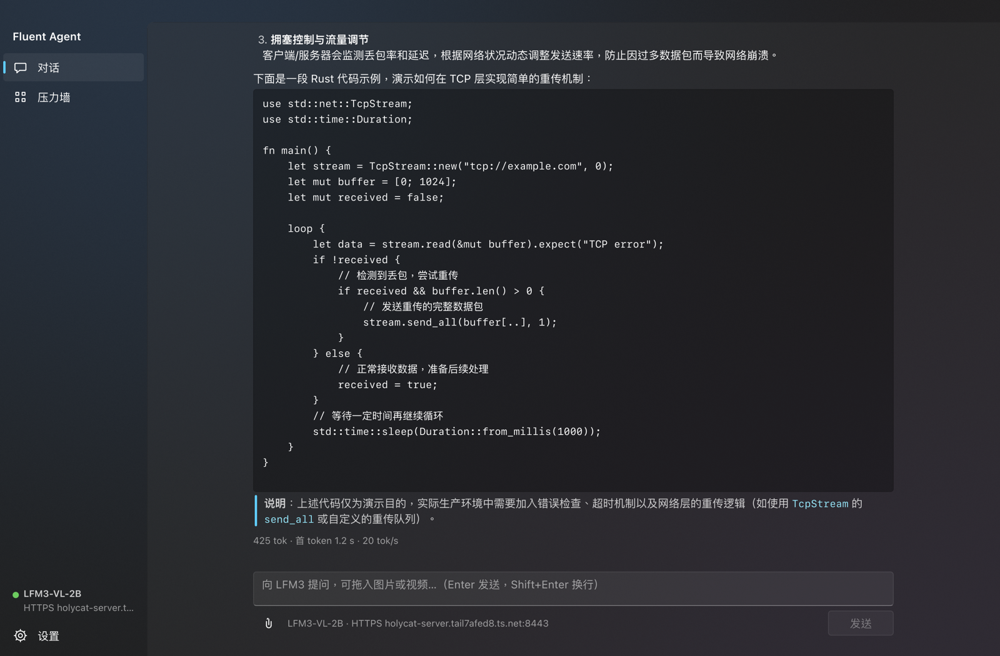

# Fluent Agent

纯 Rust 的流式 Agent 运行时和 Fluent Design 桌面客户端，为差网络而设计：高丢包、延迟抖动、连接中断时，已经收到的文本不丢、不重复，流会从断点继续。

压测结果见 [docs/STRESS_REPORT.md](../../docs/STRESS_REPORT.md)。



## 组成

| crate | 作用 |
|---|---|
| `agent-rt` | 运行时：HTTPS 传输、SSE 与 JSON 解码、断点续传、工具调用、图片和视频输入 |
| `fluent` | UI 工具包：wgpu 实例化渲染器、增量文字排版、Fluent 2 设计 token 和控件 |
| `app` | 桌面应用 `fluent-agent`：对话页、128 路压力墙、设置页 |
| `mewrk` | 桌面应用 `mewrk`：Mewrk 的纯 Rust 重写，见 [crates/mewrk/README.md](../mewrk/README.md) |
| `mewrk-host` | 从 Mewrk 搬来的宿主，加上替换 Tauri 的替身和进程内的模型层 |
| `mewrk-client` | Mewrk 的应用状态和运行控制 |
| `panes/*`、`ui/*` | Mewrk 的各个界面：终端、审阅、文件、任务、浏览器、时间线、输入框、设置 |
| `mewrk-term` | 终端模拟：`alacritty_terminal` |
| `mewrk-panes` | 语法高亮 |
| `chaos` | 测试基础设施 `chaosgw`：TLS 网关（可注入故障）、确定性 mock、基于 netns + netem 的弱网实验室 |
| `stress` | 压测器 `stress`：单次压测 `run` 和全矩阵 `matrix` |

`fluent-agent` 和压测工具的依赖全部是 Rust：TLS 用 rustls + Graviola，GPU 用 wgpu，字体用 swash。它们的依赖树不编译任何 C 代码，所以静态 Linux 二进制可以直接从 macOS 交叉编译（`.cargo/config.toml`）。`mewrk` 不在此列：它的预览面板是 Chromium。

## 运行

```bash
cargo build --release
```

连接一个 OpenAI 兼容的明文端口（默认就是这个地址）：

```bash
target/release/fluent-agent --url http://127.0.0.1:8080/v1
```

不连服务器，用内置 mock 看 128 路压力墙：

```bash
target/release/fluent-agent --mock --swarm --size-choice 4
```

经过 HTTPS 网关连接：

```bash
target/release/fluent-agent --url https://HOST:8443/v1 --ca ca.pem
```

可以把图片或视频拖进窗口，也可以点附件按钮。视频以 base64 发送，由服务端的 ffmpeg 解码（2 fps，4 到 768 帧）。

## 压测

交叉编译并部署（目标机器不需要 Rust）：

```bash
cargo build --release --target x86_64-unknown-linux-musl -p stress -p chaos
```

```bash
scp target/x86_64-unknown-linux-musl/release/{stress,chaosgw} user@host:lfm3-stress/bin/
```

在目标机器上跑矩阵。它会自己创建弱网、启动网关，跑完后自己清理：

```bash
./bin/stress matrix --out runs/x --profiles clean,loss5,burst,loss10,loss20,flap --scenarios text,image,video,mixed,agent,count -c 128 --image media/hd.png --video media/test.mp4
```

需要免密 `sudo` 来创建网络命名空间。它只碰两个新建的 netns 和其间的 veth，不动防火墙、路由或真实网卡。

`chaosgw netlab list` 列出全部网络配置。

## 设计要点

**断点续传。** 连接断开后，把已收到的文本（包括 `reasoning_content`）作为 assistant 消息前缀发回，模型从该处继续。服务端有提示词缓存，所以代价是一次 prompt 评估，而不是重新生成。半截的工具调用无法前缀续写，会被丢弃重做；工具只在一轮完整结束后才执行，因此重试不会让工具运行两次。

**区分"死链"和"服务端忙"。** 这是整个运行时最容易出错的地方。重连能救死链，却会害死繁忙的服务端：媒体编码是串行的，并且阻塞所有流的解码，放弃一个只是在等待的请求，等于把工作又排到队尾。卡死上限因此是 `8 s + 已知编码负载 × 1.5`，每次重试没有进展就翻倍，所以无论负载来自哪里，重试都会收敛。

**每流一条连接。** HTTP/2 多路复用在丢包时会让一个丢包阻塞同一连接上的所有流。实测吞吐只有 HTTP/1.1 的 18% 到 25%，默认不使用。

**增量文字。** 通用文字引擎在段落变化时重新整形整段，流式输出因此是平方复杂度。这里的工作单元是词：整形结果按词缓存，完成的行不再触碰，追加只重做尾部那个未完成的词。

**合并而非排队。** token 比帧多得多。每个会话的收件箱会合并相邻文本，所以积压无法形成：帧来得再晚，看到的也是一段文本，而不是几千条消息。窗口每帧最多被唤醒一次，内容不变时不渲染。

## 测试

```bash
cargo test --workspace
```

`agent-rt/tests/e2e.rs` 用确定性 mock 通过真实 socket 和 TLS 验证逐字节一致性，包括 128 路故障风暴。`fluent/tests/widgets.rs` 用脚本化输入验证控件行为，不需要 GPU。

## 已知限制

- Mica 是着色器近似（底色加两处柔和色调），没有采样真实壁纸。
- 没有纯 Rust 的 H.264 解码器，所以视频附件显示元数据卡片，没有首帧预览。
- 没有双向文字（RTL 按逻辑顺序显示）。
- 续传依赖服务端支持 assistant 前缀；媒体在每次重试时都要重新上传，没有可续传的上传。
- Windows 和 Linux 的 GUI 只验证了能编译，没有实际运行过。
