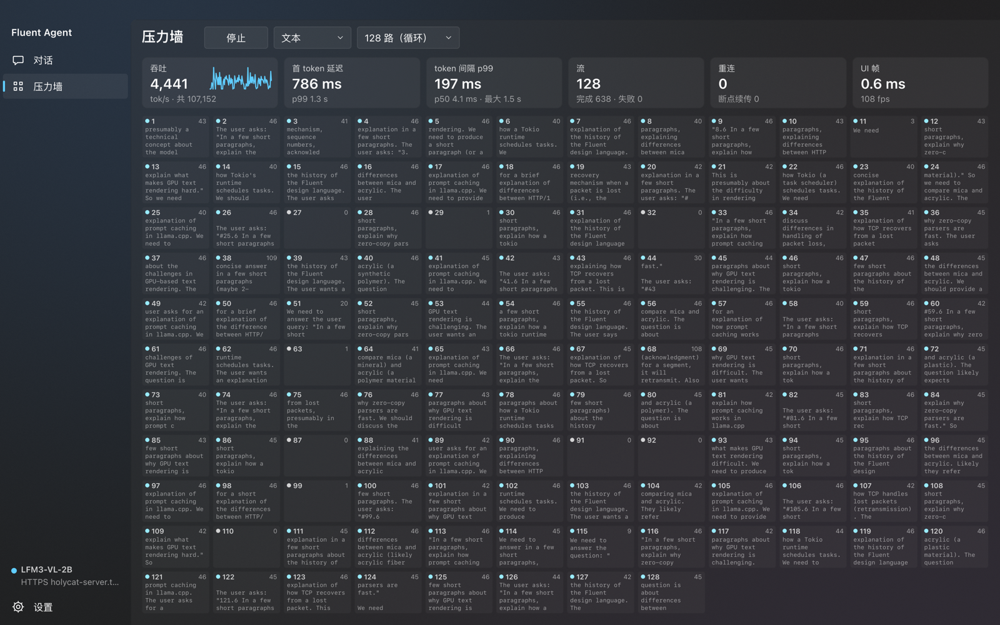

# Fluent Agent 压测报告

测试对象：LFM3-VL-2B（llama-server，128 slot，RX 9070 XT），日期 2026-11-03。原始数据在 [results/](results/)。



## 结论

- **21,144 个请求全部成功，失败数为 0。** 范围涵盖真实 TLS、最高 20% 的真实丢包、突发丢包、时变网络和注入的断流。
- **没有泄漏 slot。** 每组跑完后直接查询 `/slots`，占用数都回到 0。
- **续传没有损坏文本。** 真实模型上 2,048 个计数任务发生了 597 次续传，拼接错误为 0（没有重复或缺失的数字）。
- **工具严格只执行一次。** 注入断流时，4 组工具测试中半截工具调用被丢弃重做了 56 次，每组 128 个任务都正好执行 128 次工具，工具错误为 0。
- **UI 在 128 路下有充足余量。** CPU 帧时间 p99 约 1–2 ms，一帧预算是 8.3 ms（120 Hz）。
- **最大的弱点是在高丢包下上传大媒体。** 这是 TCP 的物理限制，见[已知弱点](#已知弱点)。

## 测试方法

```
stress（lfmc netns）──veth + netem──▶ chaosgw TLS 网关（lfms netns）──loopback──▶ llama-server
```

- **丢包是真实的。** netem 工作在两个 netns 之间的 veth 上，内核 TCP 会真实经历重传、RTO 退避和拥塞控制。TSO/GSO 已关闭，否则 64 KB 的超级包会被当作一个包丢弃。MTU 为 1400。
- **HTTPS 是真实的。** TLS 由 rustls + Graviola 实现，使用私有 CA。
- **丢包率经过核实。** 每次运行都读取 netem 和内核 TCP 计数器，实测值列在下表最后一列。与配置偏差过大时压测器会报警，这一轮没有触发。
- **隔离。** 没有改动防火墙、路由或真实网卡。测试结束后 netns 已删除，临时加载的内核模块也已卸载。

校验压测器本身：README 记录 128 路 3,734 tok/s、TTFT p50 635 ms，本压测器明文直连测得 3,834 tok/s、602 ms。

| 配置 | 单向延迟 / 抖动 | 丢包（每个方向） |
|---|---|---|
| clean | 0 | 0 |
| wan | 20 ms / 5 ms | 0.1% |
| jitter | 50 ms / 90 ms（pareto） | 0.5% |
| loss5 | 40 ms / 50 ms | 5% |
| burst | 40 ms / 60 ms | 约 11%，平均每次突发 8 个包 |
| loss10 | 60 ms / 80 ms | 10% |
| loss20 | 80 ms / 120 ms | 20%，另加 1% 重复、0.1% 损坏 |
| flap | 每几秒切换一次 | 在上述状态间循环，每 28 s 周期含 2 s 全断 |

| 场景 | 内容 |
|---|---|
| 文本 | 128 路，约 90 token 提示词，输出 96 token |
| 图片 | 128 路，1280×720 PNG（94 KB） |
| 视频 | 128 路，4 秒 360p H.264（22 KB） |
| 混合 | 70% 文本、20% 图片、10% 视频 |
| 工具 | 模型调用 `calc`，再报告结果，校验答案 |
| 计数 | 从 1 数到 60，校验序列，用于发现拼接错误 |

## 主矩阵（128 路）

除下面单独说明的对照组外，每格只跑一轮，所以尾部数字噪声较大。

| 网络 | 场景 | 成功 | 尝试 | 续传 | 总吞吐 tok/s | 单流中位 tok/s | 首 token p50 / p99 | 间隔 p99 / 最大 | >1 s 间隔 | 校验 | 实测丢包（上/下行）|
|---|---|---|---|---|---|---|---|---|---|---|---|
| clean | 文本 | 256/256 | 256 | 0 | 3,508 | 34.3 | 663 ms / 1.2 s | 181 ms / 346 ms | 0 | – | 0.0% / 0.0% |
| clean | 图片 | 128/128 | 128 | 0 | 397 | 34.3 | 14.1 s / 14.1 s | 49 ms / 50 ms | 0 | – | 0.0% / 0.0% |
| clean | 视频 | 128/128 | 128 | 0 | 327 | 34.6 | 17.4 s / 17.4 s | 33 ms / 64 ms | 0 | – | 0.0% / 0.0% |
| clean | 混合 | 256/256 | 256 | 0 | 1,058 | 14.8 | 2.8 s / 6.1 s | 1.1 s / 3.4 s | 222 | – | 0.0% / 0.0% |
| clean | 工具 | 128/128 | 256 | 0 | 793 | 9.3 | 1.5 s / 1.6 s | 345 ms / 423 ms | 0 | 125/128 | 0.0% / 0.0% |
| clean | 计数 | 128/128 | 128 | 0 | 4,135 | 41.3 | 739 ms / 759 ms | 27 ms / 273 ms | 0 | 128/128 | 0.0% / 0.0% |
| wan | 文本 | 256/256 | 256 | 0 | 3,661 | 39.0 | 787 ms / 998 ms | 84 ms / 325 ms | 0 | – | 0.1% / 0.1% |
| wan | 图片 | 128/128 | 128 | 0 | 391 | 32.0 | 14.2 s / 14.2 s | 143 ms / 166 ms | 0 | – | 0.1% / 0.1% |
| wan | 视频 | 128/128 | 128 | 0 | 324 | 34.6 | 17.6 s / 17.6 s | 52 ms / 105 ms | 0 | – | 0.1% / 0.0% |
| wan | 混合 | 256/256 | 256 | 0 | 1,078 | 15.3 | 2.9 s / 5.9 s | 1.1 s / 3.0 s | 238 | – | 0.1% / 0.1% |
| wan | 工具 | 128/128 | 256 | 0 | 708 | 8.8 | 1.7 s / 1.8 s | 399 ms / 522 ms | 0 | 128/128 | 0.1% / 0.1% |
| wan | 计数 | 128/128 | 128 | 0 | 3,944 | 40.9 | 877 ms / 942 ms | 51 ms / 282 ms | 0 | 128/128 | 0.1% / 0.1% |
| jitter | 文本 | 256/256 | 256 | 0 | 3,369 | 36.5 | 662 ms / 1.3 s | 327 ms / 914 ms | 0 | – | 0.5% / 0.5% |
| jitter | 图片 | 128/128 | 128 | 0 | 386 | 25.6 | 13.7 s / 14.4 s | 500 ms / 10.5 s | 19 | – | 0.4% / 0.6% |
| jitter | 视频 | 128/128 | 128 | 0 | 315 | 34.6 | 17.5 s / 17.8 s | 337 ms / 3.9 s | 5 | – | 0.5% / 0.6% |
| jitter | 混合 | 256/256 | 256 | 0 | 1,008 | 12.5 | 2.5 s / 6.2 s | 1.5 s / 2.0 s | 322 | – | 0.5% / 0.5% |
| jitter | 工具 | 128/128 | 256 | 0 | 652 | 8.5 | 1.7 s / 2.1 s | 424 ms / 1.8 s | 2 | 125/128 | 0.5% / 0.6% |
| jitter | 计数 | 128/128 | 128 | 0 | 3,499 | 38.9 | 717 ms / 1.4 s | 310 ms / 1.0 s | 1 | 128/128 | 0.5% / 0.4% |
| loss5 | 文本 | 256/256 | 256 | 0 | 3,251 | 34.8 | 641 ms / 1.7 s | 245 ms / 1.2 s | 1 | – | 5.0% / 5.0% |
| loss5 | 图片 | 128/128 | 128 | 0 | 374 | 7.0 | 9.0 s / 14.5 s | 5.4 s / 6.3 s | 80 | – | 4.0% / 5.1% |
| loss5 | 视频 | 128/128 | 128 | 0 | 319 | 32.9 | 17.4 s / 17.6 s | 247 ms / 3.3 s | 2 | – | 4.6% / 4.9% |
| loss5 | 混合 | 256/256 | 256 | 0 | 1,000 | 11.9 | 2.3 s / 6.6 s | 1.3 s / 2.1 s | 389 | – | 4.5% / 4.9% |
| loss5 | 工具 | 128/128 | 256 | 0 | 688 | 8.6 | 1.7 s / 1.9 s | 382 ms / 1.0 s | 1 | 128/128 | 4.8% / 5.0% |
| loss5 | 计数 | 128/128 | 128 | 0 | 2,694 | 39.5 | 757 ms / 3.3 s | 238 ms / 2.2 s | 1 | 128/128 | 4.9% / 4.7% |
| burst | 文本 | 256/256 | 256 | 0 | 1,856 | 32.7 | 631 ms / 2.6 s | 443 ms / 4.7 s | 31 | – | 11.2% / 10.7% |
| burst | 图片 | 128/128 | 128 | 0 | 322 | 17.7 | 13.6 s / 15.1 s | 2.5 s / 4.8 s | 137 | – | 8.6% / 12.5% |
| burst | 视频 | 128/128 | 131 | 3 | 211 | 25.4 | 16.8 s / 18.0 s | 493 ms / 10.7 s | 26 | – | 11.1% / 11.7% |
| burst | 混合 | 256/256 | 256 | 0 | 893 | 11.9 | 1.8 s / 7.5 s | 804 ms / 2.7 s | 61 | – | 9.7% / 9.1% |
| burst | 工具 | 128/128 | 257 | 1 | 175 | 7.1 | 1.3 s / 4.2 s | 758 ms / 9.5 s | 11 | 121/128 | 11.2% / 10.1% |
| burst | 计数 | 128/128 | 128 | 0 | 2,059 | 37.6 | 682 ms / 2.7 s | 372 ms / 3.7 s | 24 | 128/128 | 10.1% / 10.3% |
| loss10 | 文本 | 256/256 | 256 | 0 | 1,929 | 31.8 | 687 ms / 3.3 s | 453 ms / 6.9 s | 36 | – | 9.7% / 9.9% |
| loss10 | 图片 | 128/128 | 128 | 0 | 325 | 15.0 | 14.0 s / 15.0 s | 2.7 s / 4.2 s | 150 | – | 8.4% / 10.0% |
| loss10 | 视频 | 128/128 | 128 | 0 | 262 | 29.6 | 17.1 s / 17.5 s | 556 ms / 4.3 s | 21 | – | 8.5% / 10.0% |
| loss10 | 混合 | 256/256 | 256 | 0 | 745 | 10.8 | 1.9 s / 8.9 s | 954 ms / 6.5 s | 134 | – | 9.2% / 10.2% |
| loss10 | 工具 | 128/128 | 256 | 0 | 302 | 7.9 | 1.6 s / 4.6 s | 781 ms / 7.0 s | 16 | 126/128 | 9.5% / 10.0% |
| loss10 | 计数 | 128/128 | 129 | 1 | 1,118 | 37.0 | 878 ms / 2.4 s | 408 ms / 8.3 s | 16 | 127/128 | 9.5% / 9.7% |
| loss20 | 文本 | 256/256 | 280 | 22 | 715 | 24.6 | 1.1 s / 10.2 s | 1.2 s / 23.1 s | 302 | – | 19.8% / 19.4% |
| loss20 | 图片 | 128/128 | 150 | 3 | 60 | 34.2 | 13.6 s / 76.9 s | 807 ms / 68.9 s | 50 | – | 17.2% / 19.3% |
| loss20 | 视频 | 128/128 | 131 | 1 | 117 | 10.2 | 13.1 s / 19.1 s | 1.8 s / 16.1 s | 184 | – | 17.1% / 19.6% |
| loss20 | 混合 | 256/256 | 268 | 8 | 132 | 19.3 | 2.1 s / 50.8 s | 1.3 s / 95.1 s | 227 | – | 17.9% / 19.1% |
| loss20 | 工具 | 128/128 | 260 | 2 | 171 | 6.2 | 2.2 s / 7.0 s | 1.8 s / 12.8 s | 92 | 128/128 | 19.2% / 19.3% |
| loss20 | 计数 | 128/128 | 137 | 8 | 410 | 26.8 | 2.0 s / 8.9 s | 1.0 s / 11.1 s | 150 | 124/128 | 19.5% / 18.5% |

怎么读这张表：

- **总吞吐被掉队的流拉低。** 总吞吐是"总 token ÷ 总耗时"，一个流卡住就会拉长总耗时。看每条流的体验要看单流中位：20% 丢包下中位仍有 24.6 tok/s。
- **图片和视频的 TTFT 约 14 s 和 17 s，是串行编码造成的，不是网络。** 128 × 110 ms ≈ 14 s，128 × 134 ms ≈ 17 s。
- **校验列的未通过项都是模型行为。** 模型把工具结果转述错、把序列写成 `1 2 3 ... 60`，或在完整答案后多说一句。clean 下也会发生，没有一例是拼接错误。
- **工具场景的单流中位低**，是因为中间隔着工具调用，一个任务要跑两轮。

TLS 加网关的开销：直连 3,834 tok/s，clean 3,508 tok/s，约 9%。同类波动本身有 5% 左右（wan 比 clean 还高），所以这个差值不算精确。

## 真实模型上的注入断流

网关对每个响应 chunk 以 8‰ 的概率重置连接、1‰ 的概率静默 12 秒，并对 3% 的请求返回 503。共 12 轮，clean 和 loss10 各 6 轮。

| 场景 | 成功 | 重试原因（reset / stall / http） | 续传 | 结果 |
|---|---|---|---|---|
| 文本 | 1024/1024 | 875 / 90 / 64 | 951 | 全部完成 |
| 计数 | 512/512 | 509 / 73 / 42 | 586 | **0 拼接错误**；8 次答案完整后多说一句；3 次模型省略 |
| 工具 | 512/512 | 194 / 21 / 36 | 104 | 工具执行 512 次，工具错误 0，半截调用重做 56 次；23 次模型把结果转述错 |

时变网络 `flap`（5 轮，共 3,200 个请求）：全部成功，最大间隔 16.8 s，吞吐随网络状态波动（文本 1,559–3,508 tok/s）。

## 对照实验

### HTTP/2 多路复用（4 条连接）与 HTTP/1.1（每流一条连接）

| 网络 | HTTP/1.1 tok/s | HTTP/2 tok/s | HTTP/2 占比 | HTTP/2 最大间隔 |
|---|---|---|---|---|
| loss5 | 3,170 | 792 | 25% | 3.1 s |
| burst | 1,212 | 270 | 22% | 51 s |
| loss10 | 1,917 | 338 | 18% | 6.5 s |

每项跑 2 轮。一个丢包会阻塞同一条 TCP 连接上的所有流，所以 HTTP/1.1 是默认选择。

### 媒体并发闸门（混合场景）

串行编码会阻塞所有流的解码，闸门限制同时进入编码阶段的媒体请求数。每项跑 2 轮。

| 闸门 | 网络 | 首 token p50 | 文本间隔 p99 | >1 s 间隔 | 总耗时 |
|---|---|---|---|---|---|
| 不限（128） | clean | 3.7 s | 1,033 ms | 136 | 14.7 s |
| **16（默认）** | clean | 1.5 s | 1,044 ms | 114 | 14.2 s |
| 8 | clean | 0.8 s | 506 ms | 0 | 14.7 s |
| 不限（128） | loss10 | 1.2 s | 778 ms | 66 | 22.1 s |
| **16（默认）** | loss10 | 1.2 s | 542 ms | 32 | 27.2 s |
| 8 | loss10 | 1.2 s | 484 ms | 27 | 46.3 s |

8 在无损时最好，但闸门在上传期间也被占用，所以丢包时总耗时翻倍。默认值取 16。

主矩阵的媒体场景跑的是不限（128），默认配置在无损网络上的首 token 会更好。

### 网关 thin-stream 线性 RTO

| 网络 | 开启 tok/s | 关闭 tok/s | 差异 | >5 s 间隔（开 / 关） |
|---|---|---|---|---|
| loss5 | 3,170 | 3,146 | +1% | 0 / 0 |
| burst | 1,212 | 1,223 | −1% | 2.5 / 3 |
| loss10 | 1,917 | 1,459 | +31% | 0.5 / 3 |
| loss20 | 795 | 743 | +7% | 38.5 / 52 |

每项跑 2 轮，噪声不小。效果是正向的，但没有早期测试显示的那么大。

### 卡死超时 8 s 与 20 s（早期构建）

| 网络 | 20 s tok/s | 8 s tok/s |
|---|---|---|
| loss5 | 3,123 | 2,762 |
| burst | 642 | 1,272 |
| loss10 | 1,338 | 1,717 |
| loss20 | 342 | 611 |

各跑 3 轮，原始数据是 `results/early-stall*.json`。这组来自修复多个问题之前的构建，只说明相对趋势，绝对值与上面不可比。后来又加入了负载感知（下面的问题 1），所以 8 s 在媒体场景下不会误判。

## UI 性能

| 测试 | 吞吐 | CPU 帧时间 p50 / p99 | 内存 |
|---|---|---|---|
| 真实窗口，真实 LFM3，128 路，经 tailnet | 约 4,000 tok/s | 0.95 / 1.85 ms | 115 MiB |
| 真实窗口，mock，128 路 | 4,768 tok/s | 0.84 / 1.16 ms | 114 MiB |
| 无头，真实 LFM3，128 路，经 tailnet | 4,441 tok/s | 0.48 / 1.66 ms | 44 MiB |
| 无头，真实 LFM3，128 路，经 10% 丢包的 netem | 4,167 tok/s | 0.56 / 1.26 ms | 46 MiB |
| 无头，mock，128 路，约 9 倍真实负载 | 43,712 tok/s | 0.86 / 1.28 ms | 45 MiB |

- **GPU 时间**约 3 ms（3200×2000，M6），其中大部分是全屏的 Mica 背景。
- **43,712 tok/s 不是客户端的极限**，而是 mock 的 `sleep` 精度上限。
- **空闲零开销。** 真实窗口空闲时，6 秒内 CPU 时间增量为 0，也没有新的重绘事件。
- **帧是按需渲染的。** 接真实 LFM3 时，窗口约 25 fps，这是服务器每 25–30 ms 出一批 token 的节奏；mock 下能到 58 fps（60 Hz 显示器）。

文字管线（基准测试 `crates/fluent/examples/text_bench.rs`）：

| 指标 | 数值 |
|---|---|
| 文档增长到 1 万 / 10 万 / 100 万 token 时的追加成本 | 372 / 257 / 103 ns/token（不随文档增长，前段含缓存未命中） |
| 绘制 466 万字形文档的一屏 | 7.2 µs |
| 调整窗口后全文重排这份文档 | 67 ms |

运行时：文本场景下每 token 客户端 CPU 约 15 µs（含 TLS、JSON），压测器内存 9–13 MiB。

## 过程中发现并修复的问题

测试和独立代码审查一共发现了这些问题，每一条都有回归测试：

| # | 问题 | 怎么发现的 |
|---|---|---|
| 1 | **重试风暴。** 128 张图串行编码约 15 s，超过 8 s 卡死阈值，客户端断开重发，形成坍塌：无损网络上 1321 次尝试、141 s。现在阈值感知编码负载，连续无进展就翻倍 | 真实 LFM3 |
| 2 | **黑洞连接。** TCP 陷入退避时请求写进内核后就"完成"了，然后傻等响应头：一个流卡了 251 s | 真实 netem |
| 3 | **`max_steps` 用尽没有回答。** 现在最后一步不提供工具 | 真实 LFM3 |
| 4 | **netem 的 correlation 让丢包率严重偏低。** 配 5% 实际只有 0.2%，差点把错误的条件写进报告。现已弃用，并加入丢包率核对 | 内核计数器 |
| 5 | `calc` 工具递归爆栈，超长表达式会让整个进程崩溃 | 代码审查 |
| 6 | 重试计数不看进展，一直有进展的长回答也会被判失败 | 代码审查 |
| 7 | 收到 `finish_reason` 后的错误会重开这一轮，生成多余文本 | 代码审查 |
| 8 | 无限制接收：无视 `max_tokens` 的服务器可以撑爆内存 | 代码审查 |
| 9 | 失败或停止后，已显示的文本没有进入对话历史；取消工具时留下无结果的 `tool_calls` | 代码审查 |
| 10 | 字形图集重置后显示错字 | 代码审查 |
| 11 | Markdown：`12345*6789` 丢星号、`42\nThat` 粘连、`***重要***` 整行消失、`C:\Users` 丢反斜杠 | 代码审查 |
| 12 | HTTP/2：失败排队、重试回到坏连接、无法回退到 HTTP/1.1 | 代码审查 |
| 13 | 被遮挡的窗口再也不会被唤醒，切回前台时一片空白 | 真实窗口 |
| 14 | 字体扫描把所有字体读进内存：RSS 845 MiB，修复后 43 MiB | 基准测试 |
| 15 | HTTP/1.1 没读完结束符导致连接无法复用；格子裁剪时文本清空 | 单元测试和自查 |

## 已知弱点

- **高丢包下上传大媒体。** 5% 丢包时 8 路 10 MB 视频的首 token 要 222–283 s，无损时约 20 s。这接近 TCP 的物理上限（Mathis 公式约 80 KB/s），而且上传不可续传。
- **20% 丢包下带图请求的尾部很长。** 图片 p99 77 s，混合最大 110 s，因为失败后要整张重传。
- **续传在答案末尾有副作用。** 流恰好断在答案结束前时，模型可能在完整答案后多说一句。注入断流的 586 次计数续传里出现了 8 次。
- **媒体编码阻塞解码。** 这是服务端的行为。混合场景下，文本流即使在无损网络上也会出现 1 s 以上的间隔。闸门能缓解，但消除不了。

## 未验证和不确定的部分

- **Windows 和 Linux 的 GUI 只验证了能编译（`cargo check`），没有实际运行过。** 所有 UI 数据都来自 macOS。Fluent 的原生平台 Windows 还需要一次真实测试。
- **真实窗口的输入没有经过真人或系统事件验证。** 键盘、IME、剪贴板、点击和滚动都由脚本化输入测试覆盖（逻辑层）；拖放和文件选择器没有测过。
- **Mac 经 netem 的那组（无头）里，Mac 自己的 TCP 没有经历丢包。** 中继把链路分成两段，丢包被中继和网关之间的 TCP 吸收，Mac 只看到抖动，所以 128 路只有 1 次重连。真正的丢包结论来自 netns 内的压测器。
- **压测器和服务器在同一台机器上。** 压测器每 token 约 15 µs，影响很小，但不是零。
- **burst 配置有模型偏差。** netem 的 gemodel 按包推进状态，链路安静时一条孤流容易一直卡在"坏状态"，比真实突发更严酷。
- **一个未能复现的现象。** 有一次单路对话显示 20 tok/s，而之后 3 次测量都是 200 tok/s 左右（服务器日志也是）。当时 Wi-Fi 很不稳定，也可能是前一个测试的余波，原因没有确定。
- **矩阵之后的小改动。** 跑完矩阵后做了 lint 清理、MP4 时长溢出修复和媒体闸门默认值调整，都不影响矩阵的场景（压测器显式指定闸门）。最终二进制已重新部署，但没有再跑一遍全矩阵。

## 复现

```bash
cargo build --release --target x86_64-unknown-linux-musl -p stress -p chaos
```

```bash
scp target/x86_64-unknown-linux-musl/release/{stress,chaosgw} ubuntu:lfm3-stress/bin/
```

服务器上：

```bash
cd ~/lfm3-stress && ./bin/stress matrix --out runs/x --profiles clean,loss5,burst,loss10,loss20 --scenarios text,image,video,mixed,agent,count -c 128 --image media/hd.png --video media/test.mp4
```

注入断流：加上 `--gateway-args "--reset-per-mille 8 --stall-per-mille 1 --stall-ms 12000 --503-per-mille 30"`。
